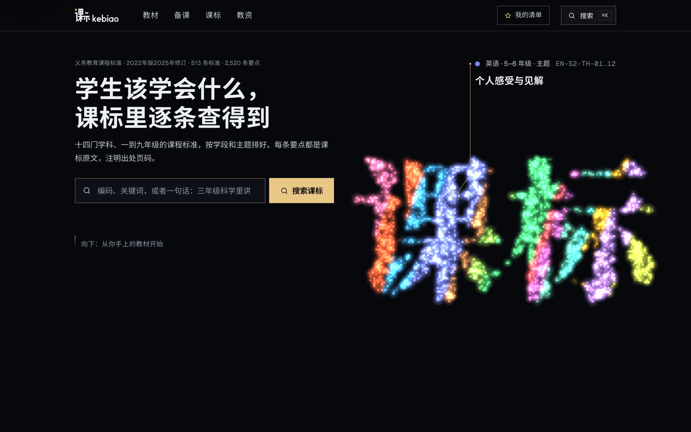
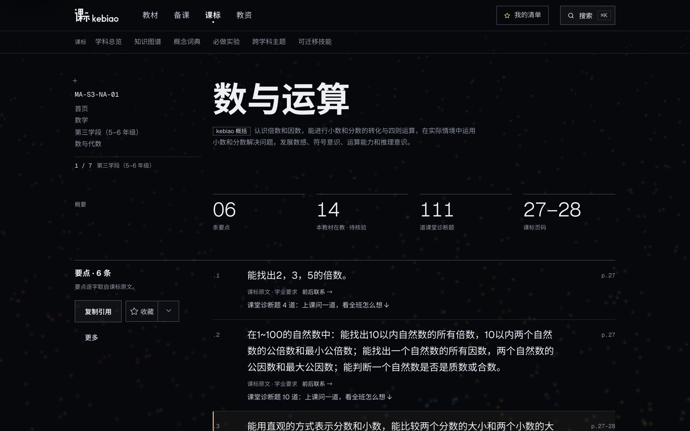
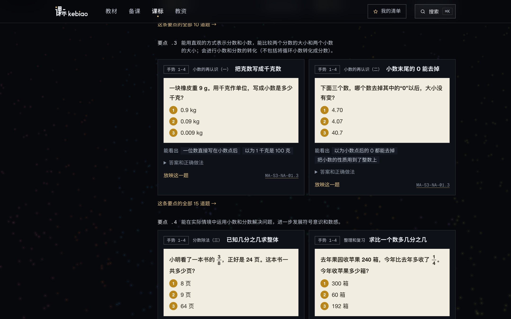
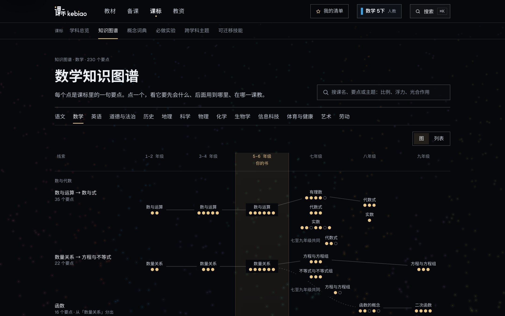
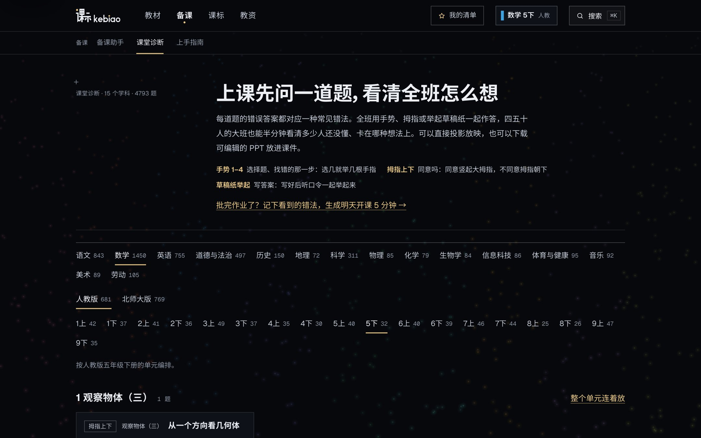
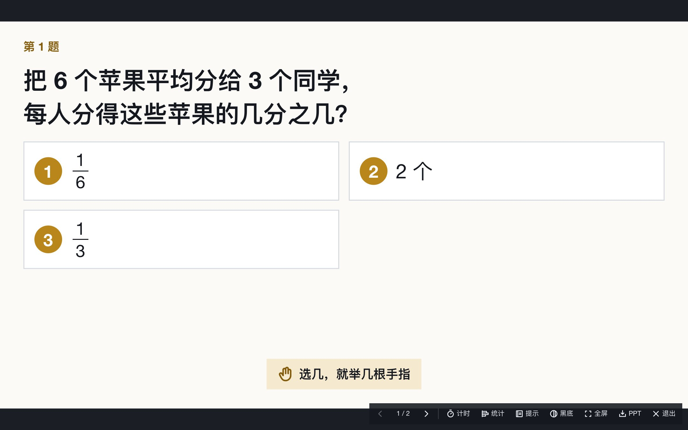

<p align="center">
  <a href="https://www.kebiao.org/">
    
  </a>
</p>

<h1 align="center">kebiao 课标</h1>

<p align="center"><strong>教什么、怎么教、怎么评，一条条对准原文。</strong></p>
<p align="center">老师做的免费备课网站：义务教育课程标准、教材与课堂诊断题的结构化索引</p>
<p align="center"><sub>A free, source-aware index of China's K–9 curriculum standards, textbooks and classroom diagnostic questions — built by a teacher, for teachers.</sub></p>

<p align="center">
  <a href="https://www.kebiao.org/"><strong>在线使用</strong></a> ·
  <a href="https://www.kebiao.org/textbooks">从教材开始</a> ·
  <a href="https://www.kebiao.org/checks">课堂诊断</a> ·
  <a href="https://github.com/NBrangerF/China-Textbook-New">下载最新版教材 PDF</a> ·
  <a href="https://www.kebiao.org/feedback">反馈</a>
</p>

<p align="center">
  <a href="https://github.com/NBrangerF/kebiao/actions/workflows/quality-gates.yml"></a>
  <a href="./public/data/v2/manifest.json"></a>
  <a href="./public/data/textbooks/manifest.json"></a>
  <a href="./data/checks/README.md"></a>
  <a href="./DATA_LICENSE.md"></a>
</p>

<p align="center">
  <a href="https://www.kebiao.org/">
    
  </a>
</p>

## 为什么做 kebiao

现在什么都能一键生成：动画、课件、教案。可一节课最要紧的三件事——**教什么、怎么教、怎么评**——最底下的那层信息，常常没人认真核对：课标原文到底怎么写，这一课对应哪几条，学生到底学会没有。

kebiao 不做动画，也不做一键生成。它只把这一层做准：每条课标都是原文、注明页码；每一课都对好课标、摘出教材原话；每一页教材都有能直接投影的诊断题。kebiao 整理和推断的部分，都和原文分开标注。

全部免费。

## 一节课的三个问题

| 老师的问题 | 在 kebiao 里 |
| --- | --- |
| **教什么**<br>这一课对应哪几条课标？学生要达到什么？ | [**课标**](https://www.kebiao.org/standards)：14 门学科、1–9 年级，513 条标准拆成 2,520 条要点，每条逐字取自课标原文并注明页码。<br>**课堂学习目标**：16,728 条，每条写明依据哪条要点、用了课标哪句原话、怎样算做到。<br>**目标体检**：在[备课助手](https://www.kebiao.org/lesson-plan?check=1)里贴进自己写的目标，逐条对到课标，看依据、程度和缺了什么。 |
| **怎么教**<br>学生之前要先会什么？有什么现成资源？ | [**教材馆**](https://www.kebiao.org/textbooks)：174 册教材（人教、统编、北师大、外研社等 12 个版本），8,370 课逐课对到课标要点，每条对应都摘了教材原话和页码。<br>[**知识图谱**](https://www.kebiao.org/knowledge-graph)：912 条「要先会」关系，学生卡在这一课时，往前找是哪一课没学会。<br>**同步课与资源**：国家中小学智慧教育平台同步课 7,039 节，按课挂好；另有 17 个国内官方平台。<br>[**备课助手**](https://www.kebiao.org/lesson-plan)：从教材的一课起草有课标依据的教案、单元设计、说课稿和试讲稿，可导出 Word。 |
| **怎么评**<br>上完课，全班到底懂了没有？ | [**课堂诊断**](https://www.kebiao.org/checks)：4,793 道诊断题，教材每一页都有，附 6,808 个典型错误想法和「怎么接」。上课先问一道，全班举手指作答，一眼看见谁在怎么想；可以直接投影，也能导出 PPT。批完作业，还能记下看到的错法，生成明天开课的 5 分钟。 |

## 产品截图

| 一条课标：原文、页码、教材在哪教 | 同一页往下：这条要点的课堂诊断题 |
| --- | --- |
| [](https://www.kebiao.org/standards/MA-S3-NA-01.3) | [](https://www.kebiao.org/standards/MA-S3-NA-01.3) |

| 从手上的教材开始：每一课教哪几条课标 | 知识图谱：要先会什么，后面用在哪 |
| --- | --- |
| [](https://www.kebiao.org/textbooks/ed_1bb9d396d4d884aee79e) | [](https://www.kebiao.org/knowledge-graph/math) |

| 课堂诊断：按学科、教材、单元找题 | 放映：上课先问一道，选几就举几根手指 |
| --- | --- |
| [](https://www.kebiao.org/checks) | [](https://www.kebiao.org/checks/present?q=ma-5b-20) |

## 还有这些

- [**概念词典**](https://www.kebiao.org/concepts)：大单元、教学评一致性、作业设计等常用说法，每条都有核对过的课标引文。
- [**必做实验**](https://www.kebiao.org/experiments) 与 [**跨学科主题**](https://www.kebiao.org/interdisciplinary)：课标里规定的学生必做实验和跨学科主题学习，按学科和年级排好。
- [**教资课标速记**](https://www.kebiao.org/teacher-exam)：给师范生的各科课程理念和核心素养，附页码。
- [**我的清单**](https://www.kebiao.org/collections)：收藏常用的课标，导入导出 JSON，生成打印版。
- [**接入智能体**](https://www.kebiao.org/ai)：通过 MCP 和插件接口，让老师常用的智能体回答时引用课标原文和页码，而不是生成「看起来像课标」的句子。
- [**最新版教材 PDF**](https://github.com/NBrangerF/China-Textbook-New)：姊妹仓库，一至九年级 147 本最新版电子教材，逐本和国家中小学智慧教育平台核对过。

## 原文和整理分开

- **原文可追溯。** 要点逐字取自《义务教育课程标准（2022年版2025年修订）》，每条注明页码；2022 年版的 2,025 个旧编码全部能找到去向。
- **整理标明是整理。** 教材对应、课堂学习目标、「要先会」关系和课程概括都是 kebiao 整理的推断层，页面上标「kebiao 整理」并注明待核验，不包装成官方结论。
- **教材对应有证据。** 每一条「这一课教这条要点」都摘了这一课材料里的原话，并注明出处页码。
- **诊断题经过核对。** 每道题都对着教材出，错误选项对应一种学生常见的想法；题库经过逐题复核。
- **老师保留最终判断。** 备课助手起草的教案只是初稿，依据都能点回原文，由老师决定用不用、怎么改。

> [!IMPORTANT]
> kebiao 是独立的整理与教学研究工具，不是教育主管部门发布的官方产品。用于正式教学、评价或政策判断时，请以课程标准官方文本为准。

## 当前数据

| 维度 | 当前公开数据 |
| --- | --- |
| 课程标准 | 《义务教育课程标准（2022年版2025年修订）》：513 条标准、2,520 条要点，逐字取自原文并注明页码 |
| 学科 | 语文、数学、英语、道德与法治、历史、地理、科学、物理、化学、生物学、信息科技、体育与健康、艺术、劳动 |
| 学段 | S1（1–2 年级）、S2（3–4 年级）、S3（5–6 年级）、S4（7–9 年级）；英语 S1–S3 对应 3–4、5–6、7–9 年级 |
| 教材 | 174 册（小学 105 册、初中 69 册），12 个版本，每本按印刷目录整理到课 |
| 教材与课标 | 8,370 课逐课对到要点，共 15,256 条对应，每条摘有教材原话（kebiao 整理，待核验） |
| 课堂学习目标 | 16,728 条，覆盖 9,235 课（含试点版本教材） |
| 知识图谱 | 912 条「要先会」关系（kebiao 整理，待核验） |
| 课堂诊断 | 4,793 道题、6,808 个典型错误想法，1,528 条要点有题 |
| 同步课 | 国家中小学智慧教育平台 7,039 节（只保存课名和链接） |
| 2022 年版旧编码 | 2,025 个，全部解析到新标准；旧记录在 `/api/v1/legacy/...` 对照 |
| 数据版本 | [`public/data/v2/version.json`](./public/data/v2/version.json)：由标准内容算出，内容不变就不变 |

这些数字描述的是当前公开数据集，不代表对所有课程文件、教材版本或教学资源的完整收录。可复现统计见 [`public/data/v2/manifest.json`](./public/data/v2/manifest.json)、[`public/data/textbooks/manifest.json`](./public/data/textbooks/manifest.json) 和 [`public/data/checks/index.json`](./public/data/checks/index.json)。

## 一起把它做好

如果你在备课时遇到一条难找、难懂或明显对错了的课标、教材对应或诊断题，请直接告诉我们。真实的课堂问题，比泛泛的「很好用」更能帮助 kebiao 改进。

教师、师范生、教研员和教育产品开发者都可以参与：

- 指出课标文本、页码、教材对应或诊断题里的具体问题；
- 提供真实的备课、教研和作业场景；
- 复核「要先会」关系、课堂学习目标和典型错误想法；
- 修复问题、补充测试或完善文档。

[提交产品反馈](https://www.kebiao.org/feedback) · [报告 GitHub 问题](https://github.com/NBrangerF/kebiao/issues/new) · [联系与合作](https://www.kebiao.org/contact)

如果 kebiao 帮你少翻了几页文件，欢迎点一个 Star，或把它分享给身边的老师。

## 给开发者与教育产品团队

同一套公开数据和 API 契约服务网站、TypeScript client、MCP 和可复用 Skill；查询逻辑集中在课程核心包。你可以只用在线 API，也可以在本地运行完整项目。

### 本地运行

建议使用 Node.js 22 和 npm。完整体验需要同时启动 API 与 Web：

```bash
git clone https://github.com/NBrangerF/kebiao.git
cd kebiao
npm ci

# 终端 A：API，默认 http://localhost:8787
npm run api:dev

# 终端 B：Web，默认 http://localhost:3000
npm run dev
```

浏览器打开 [http://localhost:3000](http://localhost:3000)。没有配置模型密钥时，检索使用确定性规则，备课助手的起草功能不可用；教材 PDF 阅读还需要本地文件或对象存储，教材目录和课标对应仍可浏览。

### 第一次 API 调用

公开字段可匿名读取：

```bash
curl -s -X POST https://www.kebiao.org/api/v1/standards/search \
  -H 'content-type: application/json' \
  -d '{"subjects":["math"],"keyword":"分数","limit":3}'
```

- [中文 API 文档](https://www.kebiao.org/api/v1/docs) · [OpenAPI YAML](https://www.kebiao.org/api/v1/openapi.yaml)
- MCP 服务：`https://www.kebiao.org/mcp`（接入方式见[接入智能体](https://www.kebiao.org/ai)）
- [TypeScript client](./packages/curriculum-client) · [课程核心包](./packages/curriculum-core) · [Agent Skill](./skills/github/zhenzheng-keyong-kebiao-skill)

### 代码地图

```text
src/                         网站界面、交互与数据加载
apps/api/                    API 与 MCP 服务
packages/curriculum-core/    查询、匹配与覆盖分析核心逻辑
packages/curriculum-client/  TypeScript API client
data/v2/                     课标（标准 · 要点）、课堂学习目标、知识图谱的源数据
data/checks/                 课堂诊断题库（按学科、教材分文件）
data/textbooks/              教材目录、逐课文本与课标对应
public/data/                 面向网站与匿名 API 的公开数据
scripts/                     数据构建、校验与预渲染脚本
docs/                        方法、契约、审校与运维文档
tests/                       API、数据与端到端测试
```

方法说明：[课标结构化方法](./docs/STANDARDS_METHOD_V2.md) · [课堂诊断题库说明](./data/checks/README.md) · [「要先会」判断说明](./data/v2/graph/prereq/README.md) · [教材与课标逐课对应](./docs/data/AUTOMATED_TEXTBOOK_STANDARD_ALIGNMENT.md)

### 质量检查

```bash
npm run typecheck       # Core、client、API 与 Vercel 类型检查
npm run test:api        # API、Core、client 与数据质量门
npm run test:ui         # 端到端与无障碍测试（需 Playwright 浏览器）
npm run build           # 完整数据重建、审计与生产构建
```

`npm run build` 会重建多类公开数据，可能改动生成文件；请在准备完整发布验证时运行。

Pull request 与 `main` 分支推送会运行 [Quality gates](https://github.com/NBrangerF/kebiao/actions/workflows/quality-gates.yml)；生产部署成功后会运行 [API smoke test](https://github.com/NBrangerF/kebiao/actions/workflows/post-deployment-smoke.yml)。

## 数据来源、版权与使用说明

- **kebiao 整理和编写的数据以 [CC BY 4.0](./DATA_LICENSE.md) 开放**：编码与结构、kebiao 整理的文字、新旧编码对照、修订与核对标记、推断层（教材对应、课堂学习目标、「要先会」关系，待核验）和 kebiao 编写的课堂诊断题。注明「kebiao 课标（https://www.kebiao.org），CC BY 4.0」即可复制、改编和商用。详见 [DATA_LICENSE.md](./DATA_LICENSE.md)。
- 课标原文取自教育部《义务教育课程标准（2022年版2025年修订）》（修订版文本取自上海市青浦区凤溪中学网站转载的日常修订版，以官方出版物为准；2022 年版见[教育部发布页](https://www.moe.gov.cn/srcsite/A26/s8001/202204/t20220420_619921.html)）。原文不是 kebiao 的作品，不在上述许可内，引用时请注明原文出处。
- 学习资源的来源与许可见各资源详情；教材仅作为索引和受控阅读入口，不代表授予转载或再分发权。第三方前端依赖见[第三方说明](./docs/legal/THIRD_PARTY_NOTICES.md)。
- 网站、API 和脚本的源代码不在数据许可范围内，代码许可尚未确定；如需复用代码，请先通过[联系页面](https://www.kebiao.org/contact)确认。
- 本项目提供的是结构化整理、检索与研究辅助，不能替代官方文件、专业课程判断或教师审核。

---

<p align="center"><strong>少翻几页文件，把更多时间留给课堂。</strong></p>
